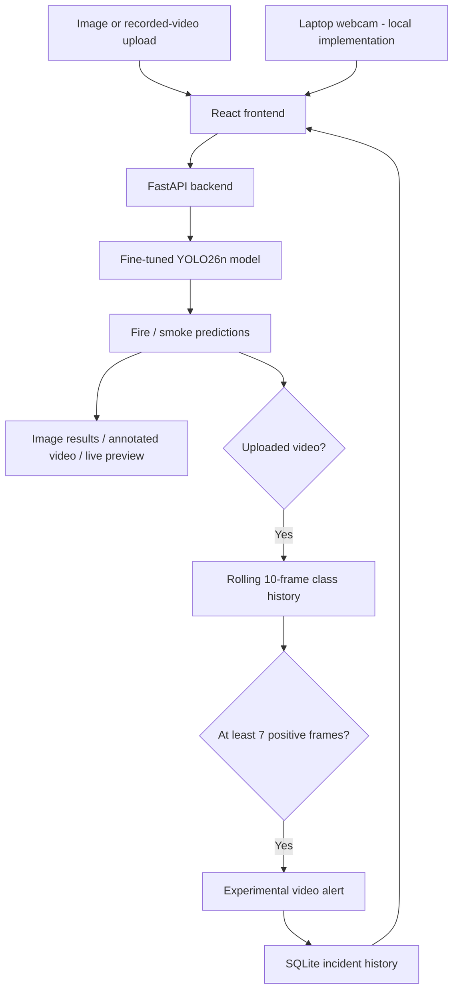

# AI-Based Early Fire Detection and Safety System

**Final Year Project (FYP) | YOLO26n · FastAPI · React · SQLite**

An AI-assisted prototype that analyzes **images, recorded video, and a laptop webcam feed** to identify **visible fire and smoke**. It generates experimental multi-frame alerts for uploaded videos and displays saved incidents in a web dashboard. The project explores affordable visual monitoring for small petrol stations, LPG/CNG shops, and other flammable-material facilities.

> [!WARNING]
> **Research prototype, not a certified fire-safety system.** It cannot detect invisible gas leaks, reliably predict explosions, guarantee early warnings, or replace certified smoke/fire detectors, gas sensors, emergency procedures, or human monitoring. Do not use it for operational life-safety decisions.

## Features and implementation status

| Feature | Details | Status |
|---|---|---|
| Image prediction | Upload JPEG/PNG images; receive fire/smoke bounding boxes and confidence. | In GitHub `master` |
| Recorded-video prediction | Process uploaded clips with YOLO and download annotated MP4 files. | In GitHub `master` |
| Video multi-frame alert rule | Confirm a **recorded-video** alert when a class appears in **at least 7 of the last 10 frames**. | In GitHub `master` |
| Incident persistence | Store confirmed **recorded-video** alerts in SQLite and retrieve recent history. | In GitHub `master` |
| React dashboard | Overview, image/video analysis, prediction visualizations, incident table and filters. | In GitHub `master` |
| Live laptop-camera prediction | Start the laptop webcam from the frontend and run fire/smoke predictions on camera frames using the existing model. | **Implemented locally — not pushed yet** |
| API documentation | Interactive FastAPI Swagger UI at `/docs` for the committed HTTP endpoints. | In GitHub `master` |

> [!IMPORTANT]
> **Live webcam prediction is a completed local project feature**, according to the development progress, but its latest code **has not yet been pushed to GitHub**. A fresh clone of `master` will not show the Live Camera page until those local changes are committed. Live-camera alert confirmation and SQLite persistence have **not been independently verified**; the documented 7/10 rule and incident storage are confirmed for uploaded videos.

## How it works



Each uploaded video can record **at most one alert for each class** (fire or smoke). Image predictions do **not** automatically create SQLite incident records. The 7/10 rule is a prototype heuristic, not a validated safety threshold. **The locally implemented live-camera prediction pipeline is separate from uploaded-video processing; whether it stores alerts must be checked in the local code.**

## Technology stack

- **AI:** Fine-tuned Ultralytics YOLO26n, PyTorch checkpoint `best.pt`
- **Computer vision:** OpenCV, NumPy
- **Backend:** Python, FastAPI, Uvicorn
- **Database:** SQLite via Python `sqlite3`
- **Frontend:** React 19, TypeScript, Vite, Lucide icons
- **Dependency management:** `uv` / `uv.lock` for Python; npm / `package-lock.json` for frontend

## Dataset and model evaluation

The fine-tuned model uses the [D-Fire dataset](https://github.com/gaia-solutions-on-demand/DFireDataset), with two object-detection classes: **0 = smoke**, **1 = fire**.

| Data split | Number of images |
|---|---:|
| Original training partition | 17,221 |
| Training after splitting validation | 15,499 |
| Validation split | 1,722 |
| Held-out test set | 4,306 |
| **Total** | **21,527** |

The validation split was created from the original training partition; the held-out test partition was reserved for final evaluation.

### Training configuration

| Parameter | Value |
|---|---|
| Starting weights | `yolo26n.pt` |
| Input size | 640 × 640 |
| Training epochs | 15 |
| Batch size | 8 |
| Trained weights | `backend/models/best.pt` |
| Training environment | Google Colab / Ultralytics |

### Reported held-out test performance

| Metric | Result |
|---|---:|
| **Precision** | **0.7426 (74.26%)** |
| **Recall** | **0.6610 (66.10%)** |
| **mAP@50** | **0.7388 (73.88%)** |
| **mAP@50–95** | **0.4124 (41.24%)** |
| Smoke mAP@50–95 | 0.4750 |
| Fire mAP@50–95 | 0.3498 |

These are **object-detection metrics**, not probabilities of successfully warning about an actual industrial accident. In particular, recall is insufficient for claims of dependable safety monitoring. The values were reported from the project's Colab experiment; the training notebooks and complete logs were **not available in the reviewed repository**.

### Re-evaluating the checkpoint

Obtain and extract the D-Fire dataset separately, with a valid YAML file containing independent `train`, `val`, and `test` paths. After installing Ultralytics:

```python
from ultralytics import YOLO

model = YOLO('backend/models/best.pt')
metrics = model.val(data='/path/to/D-Fire/data.yaml', split='test', imgsz=640)
print('Precision:', metrics.box.mp)
print('Recall:', metrics.box.mr)
print('mAP50:', metrics.box.map50)
print('mAP50-95:', metrics.box.map)
```

Do not tune the model on the test set and then report that same test set as an independent final result.

## Installation and usage

### Prerequisites

- Git
- [uv](https://docs.astral.sh/uv/) for Python dependencies
- **Python 3.14**, required by the currently committed backend `pyproject.toml` / `.python-version`
- Node.js and npm compatible with Vite 8
- Sufficient disk space for models, dependencies and processed videos

CPU inference is supported in principle but can be slow, particularly for video. A GPU can improve performance.

### 1. Clone

```bash
git clone https://github.com/zainai-maker/Ai-Based-EarlyFireDetection.git
cd Ai-Based-EarlyFireDetection
```

### 2. Start the backend

In your first terminal:

```bash
cd backend
uv sync
uv run uvicorn backend.main:app --reload --app-dir src
```

- API: <http://127.0.0.1:8000>
- Swagger documentation: <http://127.0.0.1:8000/docs>

The backend loads `backend/models/best.pt` and uses `backend/data/incidents.db` for SQLite storage. The model checkpoint is currently included in the repository.

### 3. Start the frontend

In a second terminal, from the repository root:

```bash
cd fire-detection-frontend
npm install
npm run dev
```

Open **<http://localhost:5173>**. The frontend's Vite development proxy forwards `/api/*` to the backend at `127.0.0.1:8000`. This proxy is for local development; production deployment requires separate configuration.

### 4. Analyze an image

1. Open **Analyze media**.
2. Select **Image analysis**; choose a JPEG or PNG file (up to **10 MB**).
3. Click **Run AI analysis**.
4. Inspect the returned detection classes, confidence scores and bounding-box overlays.

Image analysis does not create incident-history records.

### 5. Analyze a video

1. Open **Analyze media → Video analysis**.
2. Choose an MP4, AVI, MOV, or MKV (up to **100 MB**, approximately **60 seconds**).
3. Click **Run AI analysis** and wait for the processing result.
4. Review frame counts and alerts, then download the annotated MP4.
5. Open **Incident history** to view any confirmed alerts saved to SQLite.

The generated video uses OpenCV's `mp4v` codec; if browser playback fails, download it and open it with VLC or another compatible video player.

### 6. Use live laptop-camera prediction (local version)

> **Requires your latest local changes.** The Live Camera implementation has been completed locally but is not included in the current public `master` branch. A fresh GitHub clone therefore cannot use this feature yet.

1. Run the local FastAPI backend and React frontend with your latest camera-related changes.
2. Open the **Live Camera** option in the locally updated frontend.
3. Click **Start Camera**, allow the browser to access your laptop webcam, and watch the live preview.
4. Observe the model's fire/smoke predictions and detection overlays as frames are processed.
5. Click **Stop Camera** to release the device. Stop monitoring when you leave the page.

The webcam runs in the browser, while the locally integrated backend performs YOLO inference on sampled frames. Camera permission generally requires `localhost` or HTTPS. **Live webcam prediction is implemented; saving live predictions or confirmed live alerts to SQLite is not yet verified.** Unlike an unattended CCTV installation, browser-based capture depends on the application staying open and connected.

### 7. View incident history

The **Incident history** page displays up to the most recent **50** incident records and provides fire/smoke filtering. In the currently published backend, these are AI-confirmed *uploaded-video* alerts, **not necessarily verified real-world incidents**. Do not assume live-camera detections have been saved there.

## API reference

| Method | Endpoint | Behavior |
|---|---|---|
| `GET` | `/` | API running message |
| `POST` | `/predict/image` | Upload JPEG/PNG (max 10 MB) and receive detection JSON |
| `POST` | `/predict/video` | Analyze recorded media (max 100 MB, ~60s), store confirmed alerts |
| `GET` | `/videos/{video_id}` | Download processed video (UUID) |
| `GET` | `/incidents?limit=50` | Read newest incident records (`limit` 1–100) |

**Live camera transport (local changes only):** The locally implemented camera prediction feature communicates with the backend, but the precise WebSocket route is not documented here because its latest implementation has not been pushed. Inspect the local FastAPI router and frontend connection configuration before specifying or exposing that endpoint.

Example image request:

```bash
curl -X POST -F 'file=@/path/to/example.jpg' \
  http://127.0.0.1:8000/predict/image
```

Example structure of an image prediction (illustrative values only):

```json
{
  "filename": "example.jpg",
  "fire_detected": true,
  "smoke_detected": false,
  "detections": [
    {"class": "fire", "confidence": 0.87, "bbox": [120.0, 85.0, 390.0, 340.0]}
  ]
}
```

Saved incident fields include `id`, `video_id`, `filename`, `alert_type`, `video_time_seconds`, `confidence`, `created_at`, and `video_url`. Note that `video_time_seconds` is a timestamp **within the uploaded video**, not the current wall-clock time.

## Repository layout

```text
Ai-Based-EarlyFireDetection/
├── backend/
│   ├── models/best.pt            # Trained YOLO weights
│   ├── data/incidents.db         # SQLite records
│   ├── outputs/                  # Generated annotated video files
│   ├── src/backend/
│   │   ├── main.py               # FastAPI routes
│   │   ├── detector.py           # YOLO prediction and frame-based alerts
│   │   └── database.py           # Incident storage
│   ├── pyproject.toml
│   └── uv.lock
└── fire-detection-frontend/
    ├── src/
    │   ├── App.tsx               # Overview, analysis and incident pages
    │   ├── main.tsx
    │   └── styles.css
    ├── vite.config.ts            # Development API proxy
    └── package.json
```

**Local-only additions (pending GitHub commit):** A Live Camera frontend view and backend camera-inference integration exist in the working copy. Their exact source filenames and transport route depend on the latest local changes and are intentionally not guessed in the public repository tree above.

## Limitations and engineering notes

- **No invisible gas detection:** The RGB computer-vision model only analyzes visible image patterns.
- **Detection quality:** False positives and missed fire/smoke are possible; absence of a detection is not an assurance of safety.
- **7-of-10 heuristic:** Requires repeated detections, may delay alerts, and does not prove a real fire event occurred.
- **Live-camera availability:** Laptop webcam prediction works in the locally updated application, but it is **not yet in the published GitHub branch**. Browser-based monitoring requires the webpage and its connection to remain active; it is not an unattended industrial surveillance service.
- **No authentication:** Do not expose this development API or stored evidence on an untrusted network without additional security.
- **Local storage:** Incident records and annotated files live on disk. A record's video link will fail if its MP4 is deleted.
- **Potential privacy risk:** The repository currently tracks `incidents.db` and generated video files. Inspect for sensitive footage/data before publishing or sharing further.
- **Performance:** Recorded video processing runs synchronously and may take substantial time on CPU-only hardware.
- **Alert persistence:** Confirmed uploaded-video alerts are stored in the reviewed backend; **live-camera prediction/alert persistence has not been verified**.

## Next steps

- **Push the completed local webcam frontend and backend changes to GitHub** so a fresh clone includes the Live Camera feature.
- Test/document the exact camera communication route, permissions, disconnect recovery and performance across browsers.
- Verify whether the live stream also uses temporal alert confirmation; if not, add and validate it with cooldowns and reset handling.
- Verify or implement SQLite storage for confirmed live-camera alert events and optional snapshot evidence, clearly separated from uploaded-video incidents.
- Test nighttime footage, reflections, steam, smoke-like objects, and varied CCTV angles.
- Improve fire recall; measure false alarm rate, time-to-alert and end-to-end latency.
- Evaluate performance on inexpensive devices and, later, camera streams from IP/CCTV systems.

## Attributions and licensing

- **Dataset:** [D-Fire](https://github.com/gaia-solutions-on-demand/DFireDataset)
- **AI tooling:** [Ultralytics](https://docs.ultralytics.com/)
- **Backend:** [FastAPI](https://fastapi.tiangolo.com/)
- **Frontend:** [React](https://react.dev/) and [Vite](https://vite.dev/)

Check each dependency's, dataset's and model's license before redistributing or deploying commercially. The reviewed repository did **not** contain a top-level `LICENSE` file.

---

**Academic FYP · Experimental visual fire/smoke detection · Not a substitute for certified safety equipment.**
